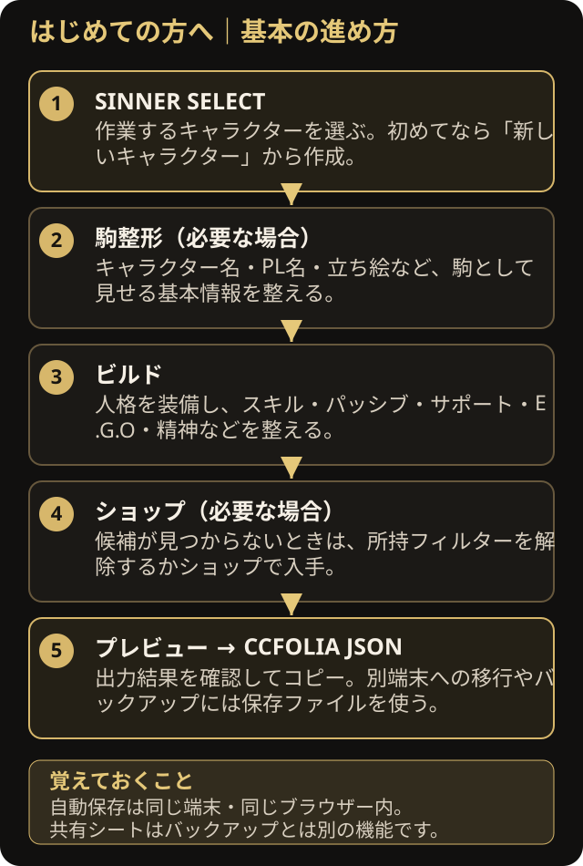
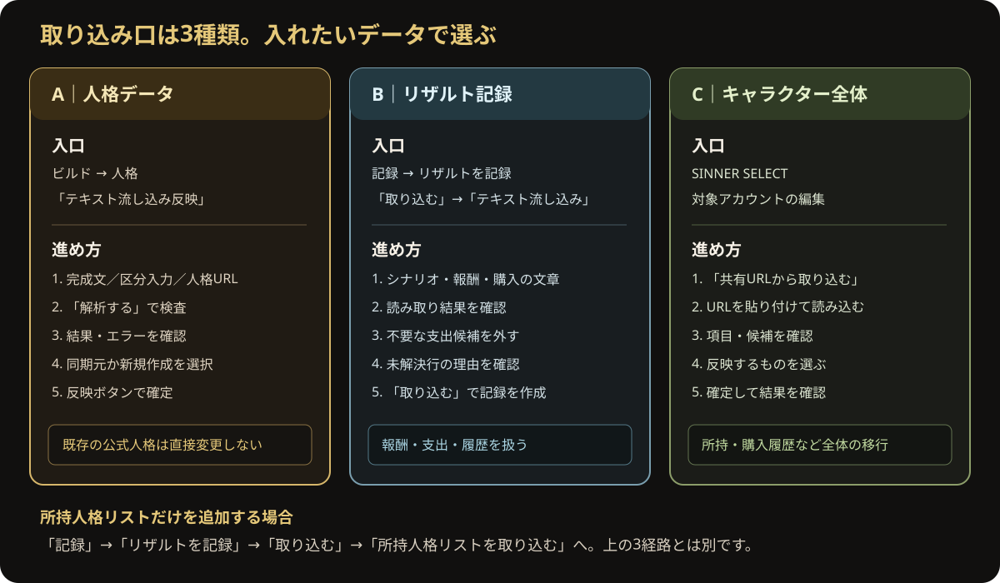
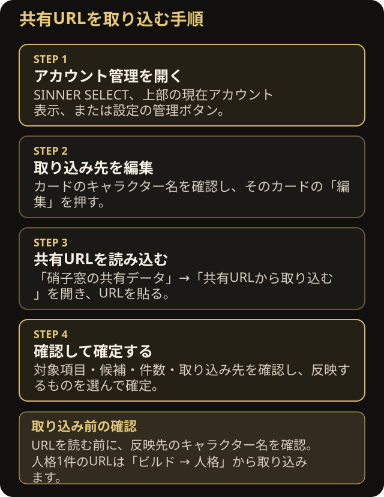
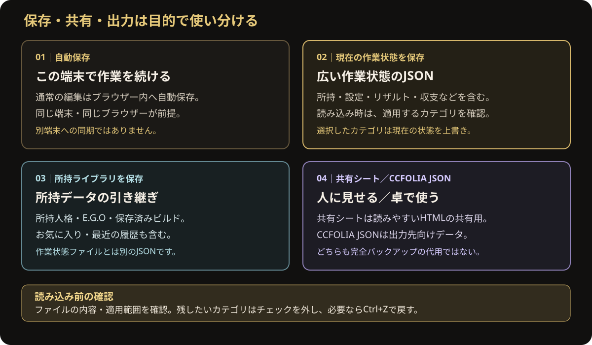

# LIMBUS BUILD TERMINAL はじめてガイド

このガイドは「機能名を知っている人向けの一覧」ではなく、**やりたいことから、押す場所が分かる**ように整理した案内です。
画面名は実際のボタン・タブに合わせています。PCでは左側のナビゲーション、スマートフォンでは画面下部のタブを使ってください。

## 1. 目的から探す

| したいこと | 操作経路 |
|---|---|
| 完成した人格データの文章を取り込む | **ビルド → 人格 → テキスト流し込み反映** |
| 硝子窓の公開人格を1件移行する | **ビルド → 人格 → テキスト流し込み反映 → 硝子窓URLから移行** |
| セッションの報酬・購入履歴を文章から記録する | **記録 → リザルトを記録 → 取り込む → テキスト流し込み** |
| 所持人格名の一覧をまとめて追加する | **記録 → リザルトを記録 → 取り込む → 所持人格リストを取り込む** |
| 硝子窓のキャラクター全体を取り込む | **SINNER SELECT → 対象キャラクターの編集 → 共有URLから取り込む** |
| キャラクターを切り替えたり編集したりする | **上部の現在アカウント表示**、または **設定 → アカウントを切替・管理** |
| サポートパッシブを装備する | **ビルド → サポート**。候補を選んで詳細を確認し、装備ボタンか選択中カードの再タップを使う |
| 作業ファイルを保存・復元する | **操作・保存 → 現在の作業状態を保存／保存データを読み込む** |
| 所持人格や保存済みビルドを引き継ぐ | **所持ライブラリを保存** |
| 共有相手に見せるHTMLを作る | **共有シートを開く** |
| CCFOLIA用データを取り出す | **CCFOLIA JSONをコピー**、またはプレビューのJSON出力 |

<details>
<summary>初回の基本手順（必要な場合だけ開く）</summary>



1. **SINNER SELECT** で作業対象のキャラクターを選びます。初めてなら「新しいキャラクター」から作成します。
2. **駒整形** は名前や立ち絵などを設定したいときに使います。
3. **ビルド** で人格を装備し、スキル・パッシブ・サポート・E.G.O・精神などを整えます。
4. 候補が見つからない場合は、ビルド側で「未所持も表示（全体から選ぶ）」を選ぶか、**ショップ** で入手します。
5. **プレビュー** で出力を確認し、必要に応じて CCFOLIA JSON をコピーします。

通常の編集はブラウザー内へ自動保存されます。ただし、同じ端末・同じブラウザー内での保存です。別端末への同期を意味しません。

</details>


## 2. テキスト流し込みは目的別に使い分ける

<details>
<summary>取り込み経路を図で確認する</summary>



</details>

### A. 人格データの文章を取り込む

1. **ビルド** を開き、**人格** の画面へ進みます。
2. **テキスト流し込み反映** を押します。人格をまだ装備していなくても開けます。
3. 入力方法を選びます。
   - **完成データを分けて入力**：名前、ステータス・パッシブ、戦術スキル、固有一覧を分けて入れる。
   - **一括テキストを貼り付け**：まとまった人格説明文をそのまま貼り付ける。
   - **硝子窓URLから移行**：公開人格URLまたは公開キャラクターシートURLから人格部分を読み取る。
4. **解析する**（硝子窓URLの場合は **公開人格を解析**）を押し、検出されたHP・SAN・速度・パッシブ・スキルなどを確認します。
5. エラーが表示された場合は不足項目を直して再解析します。
6. 既存人格へ結び付ける場合は **同期元を検索して選択** します。新しい人格として作る場合は同期元を選ばずに進みます。
7. 内容を確認し、**同期人格として反映** または **この人格を作成** を押します。

この操作は、元の公式人格データを書き換えるためのものではありません。同期元を選ぶ場合も、解析結果と反映対象を確認してから確定してください。
硝子窓の人格URLは「人格の草案を取り込む」入口です。キャラクター全体の所持品・シナリオ履歴を移す操作とは別です。所有者、メモ、チャットパレット、強化一覧は人格URLの移行対象に含まれません。

### B. リザルト・報酬・購入履歴を文章から取り込む

1. **記録** を開き、リザルト／収支の画面を表示します。
2. **リザルトを記録** カードの **取り込む** を押します。
3. メニューから **テキスト流し込み** を選びます。
4. 例のようなシナリオ見出しと報酬・購入行を貼り付けます。

```text
【第1回シナリオ】(作：作者名)
報酬｜LP:150/自我の欠片:70/人格抽出チケットx1
購入｜人格抽出x2(100LP)/EGO購入-TETH[鬼退治](75欠片)
追加購入｜壊し砕く打撃(150LP)
```

5. 表示されたリザルト・収入・支出を確認します。
6. 読み取れなかった行や、入手方法・金額を決められない支出があれば、理由を確認します。必要のない支出はチェックを外します。
7. **取り込む** を押して記録します。

**大事：** 貼り付けただけでは記録されません。確認結果を見て、最後に「取り込む」を押してください。アイテム報酬の記載は注記として保存される項目があり、必ずしも現在庫を自動変更するわけではありません。画面の説明を確認してください。

### C. 所持人格リストを取り込む

1. **記録 → リザルトを記録 → 取り込む** を開きます。
2. **所持人格リストを取り込む** を選びます。
3. 人格名を1行ずつ貼り付け、**検出する** を押します。
4. 検出された人格と未解決の名称を確認し、必要なら候補名を手動で選びます。
5. 結果を確認して **保存する** を押します。

これは所持一覧の追加です。シナリオの報酬や購入履歴を作る「テキスト流し込み」とは別の機能です。

## 3. 硝子窓のキャラクターURLを取り込むには、アカウントを編集する

<details>
<summary>操作経路を図で確認する</summary>



</details>

この入口は通常の記録画面には常時表示されていません。**対象アカウントの編集画面**の中にあります。

1. 起動時に **SINNER SELECT** が出たら、取り込み先のキャラクターを選びます。アプリを開いた後なら、上部の現在アカウント表示か **設定 → アカウントを切替・管理** で管理画面を開きます。
2. 取り込み先にしたいキャラクターのカードで **編集** を押します。
3. **硝子窓の共有データ** の中にある **共有URLから取り込む** を押します。
4. URLを貼り付け、読み込み後に表示される対象数・要確認数・候補・帰属先を見ます。
5. 反映する内容を選び、確定します。読み取りエラーや部分的に取得できなかったURLが表示された場合は、その内容も確認します。

複数URLを使う場合は、同一キャラクターの過去スナップショットであることを確認してください。異なるキャラクターの内容を混ぜる目的では使用しないでください。

### アカウントの作成・編集・切替・削除

- **作成**：SINNER SELECT の「新しいキャラクター」から名前を入力し、「作成して開く」を押します。用途タグとアイコンは必要な場合に設定します。
- **切替**：SINNER SELECT で別キャラクターのカードを選択します。データはキャラクターごとに分かれます。
- **編集**：アカウントカードの「編集」から名前、用途タグ、アイコンを変更して「保存」します。
- **削除**：削除確認には、保存領域を復元できないことが表示されます。別のアカウントと間違えていないか、必要なデータを保存したか確認してから実行してください。最後の1件は削除できません。

アカウントのデータはこの端末のブラウザー内に保存されます。別端末へ自動で同期されるわけではありません。

## 4. 保存ファイル・共有シート・JSONの違い

<details>
<summary>保存方法の違いを図で確認する</summary>



</details>

- **自動保存**：同じ端末・ブラウザーで続きを編集するための保存です。
- **現在の作業状態を保存**：所持、設定、リザルト／収支などを含む広い作業状態をJSONへ書き出します。バックアップや別端末への引き継ぎに使います。
- **所持ライブラリを保存**：所持人格・E.G.O・保存済みビルドに加えて、お気に入り・最近の履歴を含む所持データを引き継ぎます。作業状態ファイルとは別です。
- **保存データを読み込む**：ファイルから適用するカテゴリを確認します。チェックしたカテゴリは現在のデータを上書きするので、残したいものはチェックを外します。
- **共有シートを開く**：人に見せる共有用HTMLを作ります。バックアップファイルの代用ではありません。
- **CCFOLIA JSONをコピー**：現在の出力対象から、セッション用のJSONを取り出します。

誤って変更した場合は、入力欄の外でPCの **Ctrl+Z**（Macでは設定に応じて **⌘Z**）を使って戻せます。入力欄にカーソルがあるときは、まず文字入力の取り消しが優先されます。

## 5. 知っておくと迷いにくい機能

- **クイック検索**：PCは **Ctrl+K**（Macは **⌘K**）、スマートフォンは検索ボタンです。画面や項目を探せます。
- **所持のみのフィルター**：ビルドの候補が見つからないときは、所持フィルターを確認します。「未所持も表示（全体から選ぶ）」へ切り替えると、所持していない候補も探せます。
- **E.G.Oの解析**：E.G.Oタブで装備済み枠を選び、詳細から「解析を開始」します。編集を終えたら「解析を終了」で内容を保持します。
- **人格の手動編集**：「◈ 同期化して手動編集」は能力・スキル等の手動編集モードです。ゲーム上の同期ランクや同期MAXとは別の設定です。
- **並べ替え**：対応する一覧の「⋮⋮」グリップをドラッグします。スマートフォンでは押し続けてから移動します。一部の一覧では矢印ボタンも利用できます。
- **プレビューが見えない**：上部のプレビュー操作、または「操作・保存」から開閉します。スマートフォンでは本文の上に重なって表示されることがあります。

## 6. サポートパッシブを装備する

サポートパッシブの候補は、一覧で選択しただけでは詳細表示のままになっている場合があります。

1. **ビルド** を開き、ビルド内の **サポート** タブを選びます。
2. 一覧から候補を1回クリック／タップして、右側または詳細欄の説明を確認します。
3. 選択中の候補をもう一度クリック／タップするか、詳細欄の **通常スロットへ装備** を押します。装備先が死亡後専用スロットの場合は、そちらの枠・装備ボタンを確認してください。
4. 選んだ候補がスロットに表示され、装備中の表示になっていることを確認します。
5. 候補が見つからない場合は、初期状態の **所持のみ** フィルターを確認し、必要なら **未所持も表示（全体から選ぶ）** に切り替えるかショップを開きます。

「この枠を編集」は人格やサポートの効果内容を編集する操作で、候補をスロットへ装備する操作とは別です。

## 7. よくある「見つからない」

**「テキスト流し込み」が見つからない**
- 人格の文章なら **ビルド → 人格 → テキスト流し込み反映**。
- 報酬や購入履歴の文章なら **記録 → リザルトを記録 → 取り込む → テキスト流し込み**。

**「共有URLから取り込む」が見つからない**
- キャラクター全体のURLなら、まず **SINNER SELECT → 対象カードの編集** を開きます。
- 人格だけなら **ビルド → 人格 → テキスト流し込み反映 → 硝子窓URLから移行** です。

**候補が一覧に出てこない**
- 所持フィルターが設定されていないか確認し、「未所持も表示（全体から選ぶ）」やショップを使います。
- 人格の文章から作る場合は、解析結果のエラーや不足項目を確認します。

**別端末でデータが見当たらない**
- ブラウザー内の自動保存は端末間で同期されません。元の端末から「現在の作業状態を保存」や「所持ライブラリを保存」でファイルを作り、新しい端末で読み込みます。目的に応じて適切なファイルを選んでください。

---

※ 画面や表示文言は更新によって変わることがあります。操作の前に、反映先のキャラクター名・取り込み内容・保存範囲を必ず確認してください。
